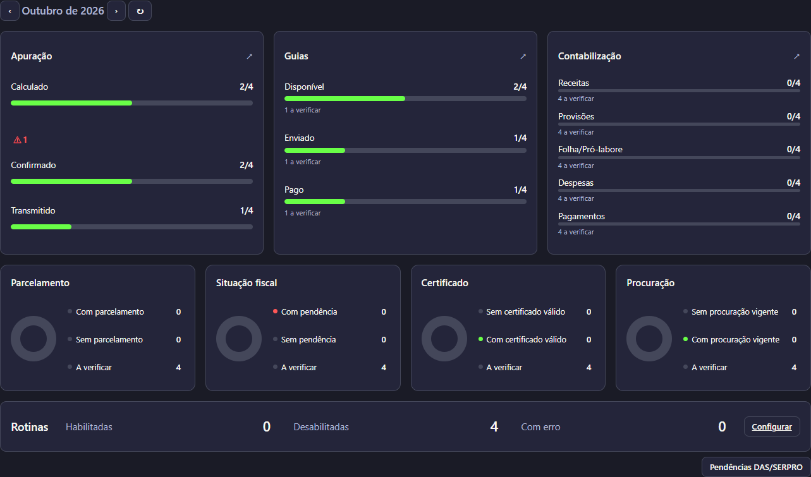
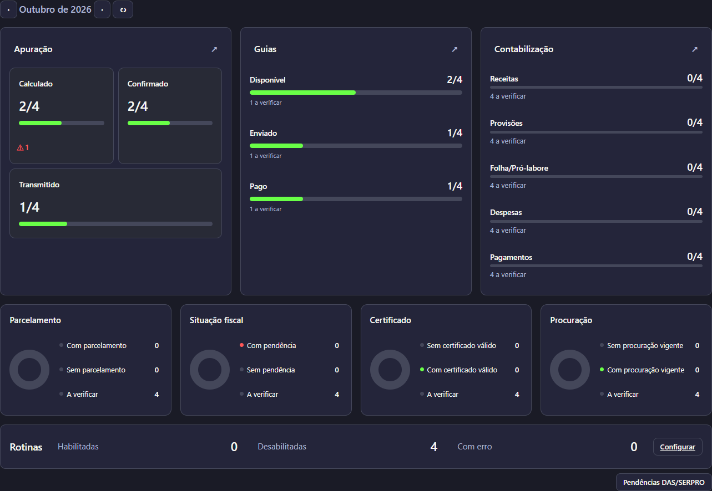

# Operações — Alternativa B, incremento B1

Base: `313904fc19214269437c90dfdde0377ca0332862`. Entrega restrita à composição principal em React; não representa a implementação completa da Alternativa B.

## Recorte implementado

Apuração apresenta os indicadores existentes em cartões de duas colunas. Guias e Contabilização mantêm barras independentes. Cabeçalhos semânticos, tokens existentes e espaçamento delimitado à composição preservam as quatro distribuições, Rotinas e o acesso às pendências DAS.

Os nomes **Calculado, Confirmado e Transmitido** e seus conjuntos permanecem intactos. Os quatro indicadores demonstrativos do protótipo não foram transportados para a aplicação. Tabela contextual permanente, seleção de lote e conferência integrada pertencem aos próximos incrementos.

## Contratos e impacto

`renderCompaniesHomePage` continua compondo `OperationsPage`. As projeções `projetarOperacoesEmpresas`/`resumirEtapasOperacoes`, os leitores `useOperationsEvidence`/`useManualInss` e seus parâmetros não mudam. Nenhum import, predicado, cálculo, fonte, denominador ou callback produtivo foi adicionado ou alterado.

- Competência, filtros e links para Empresas/Apuração preservados.
- Todos os modais, avisos, erros, estados vazios e ações permanecem disponíveis.
- Ausência de evidência continua distinta de zero e conclusão.
- Nenhuma mudança de API, autorização, FS12, transmissão, banco, workers ou regras operacionais.
- CSS novo limitado a `.operacoes-resumo-b`; não redesenha conteúdo dos modais.

## Caracterização e validação

Antes da extração visual: 183 testes aprovados em oito suítes existentes. Dois testes adicionais usam a página e seus filhos reais, simulando somente a API: verificam a quantidade de leituras, ausência de comandos e descarte de resposta tardia da competência anterior. Os mesmos dois passaram na base e na candidata.

As evidências visuais usam componentes React reais e dados sintéticos idênticos antes/depois. Nenhuma captura usa clientes reais. Ensaios de 1440, 390 e 360 px e reflow equivalente a 200%, com transporte limitado ao computador local. A comparação não é uma homologação de produção.

Regressão final: **993 testes em 80 suítes** de Operações, Apuração e carteira de empresas, sem falhas ou casos ignorados. Build completo web aprovado; permanecem avisos de tamanho de bundle e imports mistos. Governança: 88 testes; verificador: cinco testes e diagnose **5019 → 5019**, zero novas violações. Nenhum arquivo da API, pacote compartilhado ou verificador foi alterado. O diagnose da API não substitui a revisão arquitetural do frontend.

CI hospedada deve ser verificada no SHA final; seus links e resultados ficam no PR, sem substituir a evidência local.

### Comparação visual

Mesma fixture de quatro empresas sintéticas em outubro/2026: Calculado 2/4, Confirmado 2/4, Transmitido 1/4; Disponível 2/4, Enviado 1/4, Pago 1/4. As 11 métricas preservam valor e significado.

| Antes | B1 |
| --- | --- |
|  |  |
| [Antes 390 px](evidencias-operacoes-b1/before-operations-390.png) | [B1 390 px](evidencias-operacoes-b1/candidate-operations-390.png) |
| [Antes 360 px](evidencias-operacoes-b1/before-operations-360.png) | [B1 360 px](evidencias-operacoes-b1/candidate-operations-360.png) |

[Bancada completa desktop](evidencias-operacoes-b1/candidate-fullpage-1440.png) e [celular](evidencias-operacoes-b1/candidate-fullpage-390.png) mostram a integração sintética, não uma sessão autenticada em produção. [Método, fixtures e resultados](evidencias-operacoes-b1/README.md).

Zero overflow, exceções JavaScript ou acessos externos nos oito cenários base/candidata. Enter abre Calculado e Escape devolve foco em todos. Zoom nativo 200% confirmado em perfil exclusivo de testes, sem alterar o navegador do usuário. Os novos títulos h2 removem o achado de hierarquia da candidata.

Permanecem seis ocorrências `label-content-name-mismatch` reproduzidas na base e candidata, documentadas com HTML/checks. Não declarar conformidade WCAG integral, ensaio NVDA ou aparelho físico. Nenhuma regra axe foi desativada.

### Revisões independentes

Operações, UI/UX e arquitetura/backend: pareceres favoráveis ao recorte B1, sem bloqueios novos. Revisores de contratos e arquitetura examinaram o diff; UI/UX examinou componentes e capturas e solicitou os ajustes de cartões/hierarquia incorporados. Não são aprovação humana ou autorização de integração.

Arquivos produtivos revisados (SHA-256): `OperationsPage.jsx` `acce9731bcf906d129441dc8fe213e8108bcb544dd50ba892a30953003e12c91`; `operacoes.css` `ce8ea096f4b84aad3fe655c89d6c735c46dfb9dc0f83f2779af69dbdf5ec4409`.

## Limites conhecidos

Os indicadores legados não são redefinidos: posição no fluxo, evidência de confirmação e transmissão possuem conjuntos distintos. Uma declaração localizada ou informação histórica não ganha procedência fiscal nova por esta apresentação. Limitações já caracterizadas no P1/P2a continuam registradas.

O controlador foi iniciado antes das alterações. O executor produziu a primeira composição e relatou `EPERM` ao tentar testes; o principal executou as verificações. O gate de governança passou com 88 testes. A rodada foi interrompida durante a regressão API para incorporar os achados visuais. Não se declara `ready_for_human` nem aprovação da execução interrompida. Revisões independentes e CI do pacote final são evidências separadas.

## Rollback e próximo incremento

Reverter o commit deste PR restaura a composição anterior. Não há migração, conversão de dados ou reparação fiscal/contábil. Rollback não autoriza publicação.

Para B2, caracterizar separadamente a tabela contextual permanente e a preservação dos filtros/competência antes de substituir qualquer modal. Não deduzir novos indicadores ou elegibilidade de lote a partir do protótipo. Integração e B2 exigem decisão humana específica.
