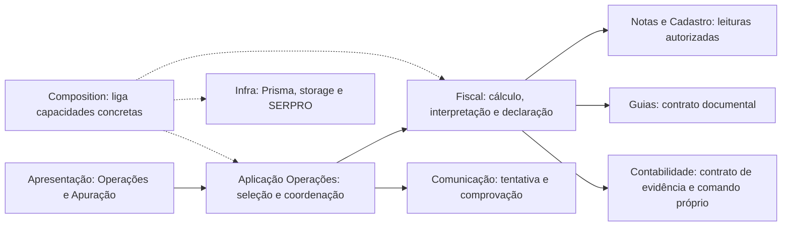
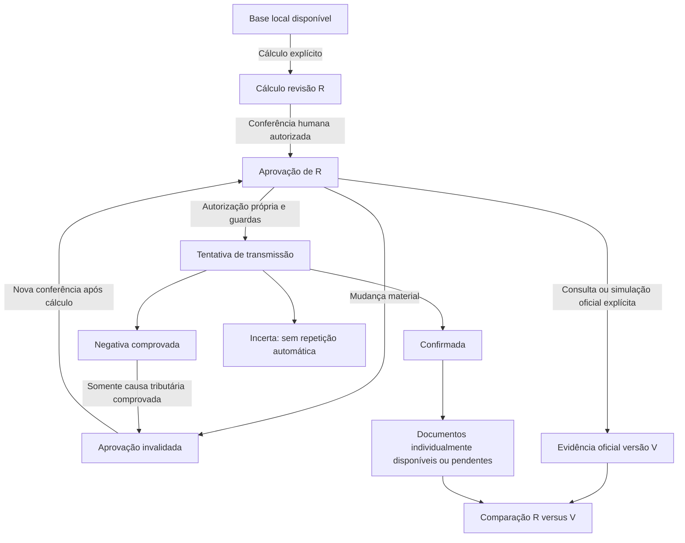

# Plano diretor — Operações e Apuração Fiscal

**Natureza:** descoberta e planejamento; nenhuma implementação funcional autorizada por este documento. Base remota confirmada em 15/11/2026: `fac886c4dbbf534f76d54d5869ebeee835a31cc9`, PR #286. Branch `docs/plano-diretor-operacoes-apuracao`; worktree `worktrees/plano-diretor-operacoes-apuracao-20261115`.

Leia junto da [avaliação de estabilidade](estabilidade-apuracao-operacoes.md), [arquitetura vigente](../governance/ARQUITETURA.md), [política](../governance/POLICY.md), [ambiente](../development/AMBIENTE.md) e [proposta UX/UI](../design/plano-operacoes-apuracao.md). O protótipo é uma representação sintética, não uma interface integrada. Aprovar o design não aprova fórmula, transmissão, schema ou publicação.

## Decisão executiva

Reutilizar o motor local e os serviços PGDAS existentes; separar explicitamente cálculo interno, simulação oficial, aprovação humana e transmissão. Operações coordena capacidades; Fiscal decide a interpretação; Guias e Contabilidade mantêm propriedade documental e contábil. Não criar motor paralelo ou status único.

A descoberta altera o plano em cinco pontos:

1. O botão de cálculo de Operações pode executar coleta e **simulação SERPRO**, não somente cálculo interno. Seu atalho recusa Fator R e sem movimento. F3 precisa reaproveitar o motor local por contrato específico, com caracterização.
2. A **prévia oficial sem transmissão já existe**. Ela continua externa e tem autorização/reserva/custo próprios. Não confundir com leitura do painel.
3. O lote atual enumera empresas no servidor e não recebe uma lista explícita selecionada na tabela. O novo lote precisa de contrato delimitado, sem alterar silenciosamente o existente.
4. A sincronização chamada de “extrato” pode persistir documento, circular, guia e provisões. Uma tela somente leitura não pode dispará-la implicitamente.
5. Agenda, execução externa e fundamentação fiscal ampliada são parciais: dia 8 ainda aparece no ciclo; registro externo de Operações atende Presumido; NBS não foi localizada como fonte efetiva dos classificadores examinados.

## F0 — mapa real, dependências e grau de implementação

Prefixos abreviados: `API = apps/api/src/`, `WEB = apps/web/src/`. As funções abaixo foram examinadas na base; nomes não são promessa de ausência de efeitos.

| Capacidade | Arquivos / contratos reais | Estado e efeitos |
| --- | --- | --- |
| Apresentação mensal | `WEB/features/operacoes/OperationsPage.jsx`, `operacoes.js`, `useOperationsEvidence.js`; `features/apuracao-v2/hooks/useApuracaoV2.js`, `pages/renderApuracaoV2Tab.jsx`, `features/apuracao/components/FechamentoModal.jsx` | Existente. Página/hook agregam comandos; não são superfícies puramente de leitura. Evidências agrupadas descartam respostas tardias. |
| Cadastro e regime | `API/application/operacoes/OperationsEligibility.js`, `API/application/fiscal/serpro/CompanyAutomationService.js`; modelos `RegimeHistorico`, `CadastroFiscal` | Existente/parcial. Regime atual não substitui prova da competência; responsabilidade contratada por capacidade não é um contrato unificado demonstrado. |
| Notas e classificação | `API/application/notas/apuracao/v2/ClassificadorService.js#classificarItensV2`, `PerfilFiscalService.js`, `ClassificacaoManualService.js#aplicarClassificacaoManual` | Existente: regras por código/atividade, cTribNac→LC116, capítulos/CNAE e pendências; fundamentação ampliada por NBS e história é proposta. Escrita manual tem Serializable/CAS, mas disputa com transmissão exige PG próprio. |
| Motor local | `MotorApuracaoService.js#calcularApuracaoLocal`, `FatorRService.js#decidirFatorR`, `AliquotaResolver.js`, `RelatorioFaturamentoService.js` na mesma pasta | Existente, legado com Prisma. `persistir:false` possui caminho específico sem log/snapshot. Caracterizar conversões, rateio, arredondamento, fontes e ausência/zero antes de extrair. |
| Conferência / fechamento | `FechamentoService.js#getDadosFechamento/calcularFechamento/salvarFechamento/transmitirFechamento/reabrirFechamento` | Existente, responsabilidades combinadas. Revisão `calculoId/idempotencyKey`, snapshot, CAS e estados de transmissão. Reabrir não retransmite. |
| Simulação oficial | `API/application/fiscal/serpro/PgdasSimulacaoService.js#simular/_executar/buildDeclaracaoPayload`, `SerproPgdasdService.js` | Existente: TRANSDECLARACAO11, `indicadorTransmissao:false`. O nome `transmitirDeclaracao` do cliente também atende este payload; conferir flag efetiva. `indicadorComparacao:false` é o comportamento atual. |
| Índice / evidências oficiais | `SerproPgdasdService.js#consultarDeclaracaoIndice`, `SerproPgdasDeclaracaoService.js#syncPgdasByCompetencia` | CONSDECLARACAO13 e CONSULTIMADECREC14 existentes. Sync não é leitura pura, inclusive ao reaproveitar arquivo salvo pode chamar contabilização. CONSDECREC15/CONSEXTRATO16 não localizados em `API`. |
| DAS e contabilidade | `API/modules/fiscal/application/persistirDocumentoDas.js`, `composition/persistenciaDocumentoDas.js`, `modules/accounting/application/contabilizarDasCapturado.js`, `composition/contabilidadeDasCapturado.js` | Extrações existentes. Guia/circular podem anteceder falha contábil. `somenteDocumentos`, acréscimos e reutilização têm contratos legados; não há transação global com SERPRO. |
| Estado operacional | `API/application/operacoes/OperationsService.js#lerOperacao/salvarOperacao`, `OperationsExecution.js#executarOperacao` | `operations:v1`, revisão, lock empresa/PA, recibo idempotente; reserva separada do despacho. DONE/EXECUTED não comprova documentos ou contabilidade completos. |
| Lote | `OperationsBatchService.js#createOperationsBatchService`, `API/routes/firm/operacoes.js` | POST `/operacoes/lotes/previa` usa usuário/competência/batchId, enumera carteira e persiste prévia de 15 minutos. Aceite usa previewId/requestId/confirmCompetencia. Não recebe seleção explícita companyIds. |
| Cálculo de Operações | `OperationsCalculationService.js#prepararCalculoOperacoes/executarCalculoOperacoes` | Prévia RR local; execução coleta ADN/prepara RBT12 e chama `FechamentoService.calcularFechamento`. Atalho NFS-e/COMPETÊNCIA exige origem RBT12 EXTRATO_PGDAS e recusa Fator R/total≤0. canCalculate não prova todos os checks posteriores. |
| Registro externo | `OperationsExternalService.js#salvarOperacaoExterna`; `FechamentoService.js#registrarEntregaExternaPgdas` | Primeiro é Presumido comprovado; segundo registra declaração humana PGDAS em `EntregaObrigacaoArquivo`. Nenhum equivale ao contrato completo proposto de evidências externas Simples. |
| Agenda / pausa | `CompanyAutomationService.js`, `CompanyAutomationPolicy.js`, `CicloSimplesService.js`, `API/workers/scheduledRoutineService.js` | Existem habilitações, pausa/version/reason/autor/data/resumedAt e bloqueio de horário anterior à retomada. Ciclo ainda contém dia 8. Capacidades/escopo/vigência/evidência de suspensão completos são parciais. |
| HTTP / assíncrono | `API/routes/firm/apuracaoV2.js`, `operacoes.js`, `workers/apuracaoBatchWorker.js`, `serproPgdasdWorker.js`, `application/tasks/ManualTaskService.js` | Fachadas existentes e serviços acoplados a Prisma. Batch de Apuração é por clique/jobId, sem loop autônomo; reserva CAS, sem replay de erro. Workers distintos não compartilham uma política universal de lock. |

Dados existentes antes de qualquer migração: `ApuracaoSnapshot` separa `dasCalculadoLocal`, procedência, `dasSimuladoSerpro`, `dasRetornadoSerpro`, divergências de valor/RBT12, atividades, folha, conferência, autor/data, declaração/recibo e estado/revisão. Reutilizar `RegimeHistorico`, `CompanyMonthlyCircular`, `LogDecisaoFatorR`, `EntregaObrigacaoArquivo`, Guide e ledgers existentes. Novo campo só após provar que fonte existente não representa o fato com integridade e autoria suficientes.

## Fluxo atual versus proposto

Atual: telas combinam leitura, classificação, cálculo local, simulação e fechamento; Operações usa projeções e atalhos com restrições próprias. Sync oficial mistura leitura externa e persistência documental/contábil. Estados e evidências existem em múltiplas fontes.

Proposto: contexto autorizado → situação local por dimensões → escolha explícita da capacidade → prévia do efeito/seleção → aprovação da revisão quando exigida → operação existente adaptada → resultado individual e evidências. Consultar o painel não consulta SERPRO, transmite ou repara dados.

Domínio recebe fatos e decide; aplicação recebe operações específicas; infraestrutura encapsula I/O; apresentação traduz contratos. Composition fornece adaptadores, sem inversão da dependência para aplicação. Não criar barramento, serviço HTTP interno ou repositório genérico. Preservar fachadas e assinaturas consumidas pelo legado.

## F2 — doze dimensões independentes

Estados desta tabela são vocabulário **proposto de projeção**, não novos enums persistidos.

| Dimensão / dono | Fato existente | Projeção proposta / evidência exigida |
| --- | --- | --- |
| 1 Regime / Cadastro-Fiscal | RegimeHistorico e regimeDoPeriodo | Comprovado/divergente/desconhecido por PA; fonte e vigência. |
| 2 Aplicabilidade / Fiscal-Obrigações | Regras atuais por regime/obrigação | Aplicável/não aplicável/a verificar; fundamento separado de habilitação. |
| 3 Responsabilidade / Cadastro-contratação | Carteira, contrato e tarefas | Contratada/externa/recusada/indefinida; fonte contratual e período. Não inferir de empresa ativa. |
| 4 Elegibilidade / dono da capacidade | Guards de Calculation/Batch/Execution | Apta/bloqueada/não verificável por capacidade e motivos, sem booleano universal. |
| 5 Forma / Fiscal-Operações | Origem do cálculo/entrega externa | Interna/externa/indefinida; não inferir por ausência de procuração. |
| 6 Cálculo interno / Fiscal | Snapshot local e procedência | Ausente/válido/desatualizado/incompleto/erro; revisão das fontes. |
| 7 Aprovação / Fiscal-Operações | Revisão/fingerprint, ator/data | Pendente/válida/invalidada; ligada à revisão exata, nunca à empresa genericamente. |
| 8 Declaração / Fiscal | Número, recibo, transmitidoEm e reserva | Não consultada/ausente confirmada/simulada/transmitida comprovada/incerta; versão/origem. |
| 9 Documentos / Fiscal-Guias | PDF/hash/circular/Guide | Declaração, recibo, DAS e extrato individualmente disponíveis/ausentes/inválidos; revisões próprias. |
| 10 Conciliação / Fiscal | divergenciaValor/divergenciaRbt12 | Não comparável/pendente/coerente/divergente, com duas revisões/fontes. Tolerância é decisão fiscal pendente. |
| 11 Contabilização / Contabilidade | Provisões/linhas/circular | Não verificada/pendente/conferida/erro parcial/fechada; evidência contábil, não guia presente. |
| 12 Comunicação e pagamento / donos distintos | Tentativas/recibos/provas/baixas | Subdimensões separadas: disponível/enviado/entregue e não pago/declarado/confirmado/baixado, conforme contratos reais e origem. |

### Transições, permissões e invariantes

O desenho não é uma máquina única persistida: declaração externa pode existir sem B/C; documentos e contabilidade evoluem independentemente. Resultado parcial mantém fatos confirmados e lacunas. Erro de autenticação/procuração/transporte não retorna automaticamente ao motor. Incerto exige o procedimento existente, sem recuperação nova.

| Transição futura | Ator / pré-condição | Evidência / recusa / consistência |
| --- | --- | --- |
| Calcular local | Operador autorizado ou capacidade agendada aprovada; base completa | Fonte/revisão, ausência ≠ zero; operação local sem SERPRO. Persistência somente pelo contrato já caracterizado. |
| Confirmar revisão | Humano autorizado, cálculo R ainda atual | CAS/ator/data/requestId; stale/replay conflitante recusados; alteração de notas/parâmetros/folha invalida aprovação dependente. |
| Consultar/simular oficial | Autorização fiscal, procuração, custo/capacidade e reserva | Serviço/PA/revisão/resultado separados; não promover simulação a transmissão. |
| Transmitir | Aprovação R + autorização própria + revalidação no despacho | Mesma revisão e identidade; reserva e efeito externo não são atômicos. Incerto bloqueia repetição. |
| Informar externo | Humano com ACL empresa, origem e evidência | Afirmação distinta de documento oficial; recibo/DAS/extrato ausentes permanecem ausentes; sem baixa ou provisão implícitas. |
| Pausar/retomar | Responsável autorizado, motivo/escopo/período | Auditoria e revisão; pausa não dispensa obrigação; retomar não executa competências anteriores. Contrato ampliado depende de aprovação. |

### Elegibilidade por empresa e competência

| Situação | Universo / leitura | Execução e encaminhamento |
| --- | --- | --- |
| Simples comprovado, ativa, base completa | Aplicável se obrigação confirmada | Capacidade interna pode ser apta; consulta/transmissão exigem guardas próprias. |
| Sem movimento comprovado | Obrigação pode permanecer aplicável | Não equivale a receita ausente. Atalho atual Operações recusa; planejar caminho caracterizado de declaração zerada, não forçar zero. |
| Parada pelo escritório | Continua visível com pausa/motivo | Bloquear capacidade abrangida; fiscal decide obrigação, sem dispensa presumida. |
| Cadastro/folha/base incompletos | A verificar, com origem da falta | Completar dados; não emitir resultado zero ou usar histórico como verdade. |
| Sem procuração | Leitura local e registro externo conforme ACL | Bloquear serviço oficial que exige procuração; não bloquear indiscriminadamente informação humana. |
| Não contratada ou recusada pelo cliente | Responsabilidade separada da obrigação | Orientar responsável/escopo/evidência; não habilitar execução automática. |
| Inativa na carteira | Visibilidade conforme política vigente | Não inserir silenciosamente em lote; preservar histórico e obrigação. |
| Outro regime | Fora do denominador Simples | Manter recorte e fluxo próprio, inclusive Presumido externo. |
| Regime desconhecido/sobreposto/divergente | Grupo a verificar, fora do denominador comprovado | Bloquear cálculo/ato dependente até prova do período; não copiar regime atual. |

### Permissões manual e automática

| Capacidade | Manual | Automática proposta / limite atual |
| --- | --- | --- |
| Ler situação local | Sessão e ACL da empresa | Identidade de serviço com escopo de leitura; sem consulta externa por polling. |
| Coletar/preparar | Escolha explícita, fonte/custo e procuração quando cabível | Habilitação, agenda, fonte autorizada/gratuita quando exigida, pausa e reserva; sem fallback pago. |
| Calcular local | Empresa/PA/revisão e requisitos do motor | Capacidade específica e revisão ainda não tentada; não herdar transmissão. |
| Solicitar conferência | Pendência interna, sem mensagem real implícita | Criar proposta de trabalho somente pelo contrato autorizado; aprovação continua humana. |
| Consultar oficial | Ação/custo/capacidade próprios | Política separada, revalidada antes do efeito; desconhecido não autoriza. |
| Transmitir/retificar | Autorização própria e revisão aprovada | BLOQUEADO para nova política até aprovação específica; configuração ligada não é consentimento de transmissão. |

Preservar as três ACLs descritas no #286: legadas #275 com preflight ACCOUNTANT e exceção admin; lote moderno Guias com `empresasVisiveis`; lote Operações com ator ativo/vínculos por empresa e revalidação. Não harmonizar. Ator nunca vem de um ID livre do cliente; identidade de rotina não simula contador humano.

## F3 — cálculo interno e confirmação

Caracterizar antes de extrair: notas emitidas/canceladas/substituídas e competência; CNAE/atividade efetiva; mapeamentos cTribNac/LC116; segregação, RBT12, folha, regime, vigências; Decimal/Number, rateios, centavos, limites e ordem de erro. NBS, descrição e histórico serão evidências auxiliares propostas: não presumir equivalência legal automática, nem aprender regra tributária a partir de mês anterior.

Saída mínima proposta por receita/atividade: fonte dos itens, anexo candidato e fundamento, premissas, bases completas/parciais, alíquota nominal/efetiva, imposto estimado, revisão, pendências e campos desconhecidos. Reutilizar motor, não copiar fórmula na UI/Operações. Fator R legado arredonda divisão com `toFixed(4)` antes de comparar 0,28; caracterização direta é lacuna, não homologação. Receita/folha ausente não é zero; sugestão de folha anterior mantém procedência.

Em P3c, definir um único escritor para a evidência de aprovação, caracterizando o registro atual antes de transferir responsabilidades. Fiscal decide a validade do cálculo; Operações conserva a liberação operacional e a reserva. A fronteira conjunta nesta proposta não autoriza ambos a escreverem o mesmo fato nem criar duas aprovações equivalentes.

Confirmação liga ator/data à revisão completa do cálculo e insumos. Provar classificação × salvar × transmitir com duas conexões PG16, atualização concorrente, rollback, replay e mudança material; não substituir a revisão existente por hash novo sem paridade. Nenhuma fórmula, persistência ou regra de aprovação muda nesta entrega.

## F4 — PGDAS-D: capacidades verificadas

Documentação pública oficial consultada em 15/11/2026; nenhuma chamada autenticada/fiscal executada.

| Serviço | Código existente / proposta | Condição de projeto |
| --- | --- | --- |
| TRANSDECLARACAO11 | Simular com indicadorTransmissao false e transmitir com true já existem | Preservar distinção e flag; prévia oficial é efeito externo. Comparação do provedor está false no payload atual; ativação é outra decisão. |
| CONSDECLARACAO13 | Índice por PA existente; catálogo também prevê consulta anual | Índice não comprova recibo/PDF nem resolve toda reserva incerta. |
| CONSULTIMADECREC14 | Última declaração/recibo existente | Identificar versão efetiva; caracterizar sync e seus escritores antes de expor nova ação. |
| CONSDECREC15 | Não localizado em API | Avaliar necessidade de versão específica; não desenhar como comando já disponível. |
| CONSEXTRATO16 | Não localizado em API; extrato do DAS por número | Não confundir com PDF de declaração chamado “extrato” no legado. |
| GERARDAS12 / GERARDASCOBRANCA17 | Captura e interpretação existentes | Preservar escolha normal/cobrança, cache, reserva, revisão e falhas parciais. |

Fontes: [entrada da declaração](https://apicenter.estaleiro.serpro.gov.br/documentacao/api-integra-contador/pt/solucoes/integra-sn/pgdasd/servicos/entregar_declaracao_mensal_entrada/), [índice](https://apicenter.estaleiro.serpro.gov.br/documentacao/api-integra-contador/pt/solucoes/integra-sn/pgdasd/servicos/consultar_declaracao_por_ano_pa/), [última declaração/recibo](https://apicenter.estaleiro.serpro.gov.br/documentacao/api-integra-contador/pt/solucoes/integra-sn/pgdasd/servicos/consultar_ultima_declaracao_recibo/), [extrato DAS](https://apicenter.estaleiro.serpro.gov.br/documentacao/api-integra-contador/pt/solucoes/integra-sn/pgdasd/servicos/consultar_extrato_do_das/).

**Compatibilidade a investigar antes do próximo incremento PGDAS:** a entrada e o [changelog oficial](https://apicenter.estaleiro.serpro.gov.br/documentacao/api-integra-contador/pt/solucoes/integra-sn/pgdasd/changelog/) indicam `folhasSalario` obrigatória desde PA 202611. O builder legado omite lista vazia. Preparar fixtures 202610/202611, distinguir ausência/zero e obter definição fiscal; não fabricar folha, alterar payload agora ou afirmar falha produtiva sem reprodução.

Fluxo planejado: consultar índice explicitamente → identificar declaração/versão/recibo → obter somente evidências necessárias por serviços próprios → comparar com R aprovada. Se ausência confirmada, oferecer simulação existente; transmitir só em comando autorizado separado. Confirmado/negativo/parcial/incerto são resultados diferentes. Retificação é fluxo independente. Erro comprovadamente tributário volta à conferência; autenticação, procuração, transporte e incerteza não disparam recálculo/transmissão.

## F5 — contrato documental e contábil

DAS vai para Guias com empresa, PA, sourceFileId/número, bytes/hash, revisão, vencimento, valor original/atual e campos de pagamento preservados. Declaração, recibo e extrato permanecem evidências fiscais distintas, com origem, versão e identidade. Não usar valor atualizado do DAS como valor original da provisão.

Contabilidade recebe contrato específico de avaliação de evidência (receitas/tributos/origem/revisão); escrita continua comando próprio do dono. Falha depois da guia/circular permanece parcial e visível. Não gerar/corrigir/baixar/excluir lançamentos como consequência de abrir tela ou informar conclusão externa. Comunicação consome disponibilidade autorizada; tentativa, entrega e pagamento seguem separados.

## Contratos-alvo mínimos — propostas, não APIs implementadas

| Dono / operação | Entrada e resultado mínimos | Autorização, falhas e consistência |
| --- | --- | --- |
| Operações / ler situação mensal | empresa/PA → 12 dimensões, fontes, revisões, pendências, cobertura | ACL do contrato; erro de fonte é indisponível, não zero; declarar snapshot ou leituras independentes. |
| Fiscal / avaliar cálculo local | empresa/PA/revisão → resultado fundamentado | Sem rede/escrita quando leitura; capacidades específicas; mesmas recusas/precedência do motor. |
| Fiscal-Operações / conferir revisão | ator/revisão/requestId → aprovação | CAS e auditoria transacionais; stale e idempotência divergente recusados. |
| Fiscal / consultar ou simular oficial | identidade/PA/revisão/capacidade → evidência e resultado | Comando explícito, custo/procuração/reserva, incerto sem retry; não publicar resultado como transmissão. |
| Fiscal / comparar versões | R aprovada + V oficial → diferenças/limitações | Sem correção implícita; comparação somente se bases compatíveis; tolerância pendente. |
| Fiscal / registrar externo | empresa/PA/ator/origem/evidências → fatos independentes | ACL sem exigir procuração só para declaração humana; prova oficial não fabricada; revisão e auditoria. |
| Operações / preparar lote selecionado | IDs/revisões/capacidade → elegíveis/bloqueados/motivos | Contrato novo compatível, seleção exata e revalidação; nunca adaptar silenciosamente a prévia atual. |
| Guias / receber DAS | documento interpretado e identidade → guia/revisão | Reutilizar porta atual, preservar CAS/uniqueness/pagamento; sem promessa de transação global. |
| Contabilidade / avaliar evidência | fonte/PA/declaração/revisão/valores → conferência/pendências | Não altera razão; qualquer comando de escrita separado, mês fechado protegido. |

## F6 — manual, lote e automático

Planejar uma aplicação por capacidade, com iniciadores HTTP/manual e agenda chamando a mesma decisão já caracterizada. Diferenças explícitas: ator, escopo, seleção, vigência, configuração, reserva e auditoria. Não unificar locks só por conveniência nem mover efeitos para uma transação longa.

Toda execução revalida empresa/regime, procuração, pausa, revisão e autorização imediatamente antes do efeito sensível. Lote mantém resultado por item, exclui bloqueadas com motivos e não promete atomicidade coletiva com provedor. A revisão da prévia pode vencer; aceite precisa conferir novamente. Retomada não recupera períodos antigos; tentativa incerta não reabre por timeout ou reinício.

Antes de mudar agenda: conciliar dia 8 do legado com decisões 34/35, herança global/campo empresarial, desligamentos, fuso Brasília, dias úteis e horários inexistentes. Desenhar capacidades coletar/preparar/calcular/solicitar conferência/consultar/transmitir separadas; transmissão automática depende de política própria ainda não aprovada por este plano.

## Plano de PRs pequenos, testes, aceite e rollback

Cada linha é um incremento candidato, não uma ordem automática. Classificação é a do marco #286 para o comportamento proposto, não aprovação de implementação.

| ID / dependência | Entrega / classe | Testes e saída objetiva | Rollback |
| --- | --- | --- | --- |
| P0 — atual | F0/F1 + matrizes F2–F6, documental | Fontes/caminhos verificáveis, protótipos desktop/mobile, revisão dos donos, gates/CI; aprovação humana do plano/design | Reverter só docs/protótipos, sem dados. |
| P1 — P0 aprovado | Clareza/acessibilidade de evidência existente, **LIBERADO** | Componente delimitado, tokens, teclado/foco, screenshots 1440/390/360/zoom; sem novo predicado/efeito | Reverter componente e testes da entrega. |
| P2a — P0 | Caracterizar universo e contadores, **COM RESTRIÇÕES** | Conjuntos/denominadores, desconhecidos, sobreposição, paginação, permissão e paridade legada; decisão das definições | Reverter caracterização/documentação. |
| P2b — P2a | Projeção local + tabela por etapa, **COM RESTRIÇÕES** | HTTP real/ACL, PG isolamento, zero I/O externo/escrita, contagem=lista, resposta tardia; operação de leitura específica | Repor fachada/projeção antiga, sem converter estado. |
| P3a — P0 | Caracterizar motor/Fator R, **BLOQUEADO para fórmula nova** | Bordas 28%, monetário, RBT12/folha ausentes/zero, vigências, paridade base/candidata; Fiscal aprova qualquer mudança | Reverter somente testes/docs; preservar motor. |
| P3b — P3a | Expor cálculo interno reutilizado, **BLOQUEADO até provas** | Nenhuma chamada SERPRO, sem segundo motor; fontes por receita; contrato persistente separado e compatível | Reverter composição/entrada nova; preservar snapshots/auditoria. |
| P3c — P3b | Aprovação da revisão, **BLOQUEADO até PG próprio** | Duas conexões classificação×salvar×transmitir, stale/CAS/replay/rollback, HTTP real | Desabilitar entrada nova; não apagar aprovações históricas. |
| P4a — P0 | Contrato PGDAS/folhasSalario, **BLOQUEADO para alteração de payload** | Fixtures 202610/202611, flags simular/transmitir, comparação desligada; decisão fiscal e compatibilidade externa documental | Reverter adaptação isolada se autorizada, sem repetir operação. |
| P4b — P3c/P4a | Consulta oficial/comparação R×V, **BLOQUEADO até caracterização** | Índice/PDF/recibo/extrato separados, cache/partial/timeout/ACL/custo; nenhum sync implícito ao ler painel | Reverter novo consumidor; preservar evidências e reservas. |
| P4c — P4b | Transmissão/retificação separadas, **BLOQUEADO** | Autorização específica, revalidação, falhas antes/depois aceite, negativa/incerta, concorrência; doubles, nunca ato real de teste | Suspender novo despacho; não retransmitir/reverter ato fiscal por Git. |
| P5a — P2a | Resultado externo Simples, **BLOQUEADO até contrato** | Afirmação sem recibo/DAS/extrato, evidência/revisão/ACL, procuração não exigida para informar; nenhum efeito fiscal/contábil | Fechar entrada nova preservando registros e origem. |
| P5b — P4b | Evidência Guias/Contabilidade, **BLOQUEADO para escritas novas** | Identidade/hash, pagamento, original×atual, mês fechado, falha parcial; sem reparação implícita | Reverter adaptador novo, não apagar guia/lançamento/evidência. |
| P6a — P3c/P4b | Seleção explícita de lote, **BLOQUEADO até contrato próprio** | Seleção exata/mista, ACL real, expiração, replay, lote×manual, resultado por item e atraso de fila | Reverter consumidor/entrada nova, preservar tentativas aceitas. |
| P6b — P6a | Capacidades/agenda manual-automática, **BLOQUEADO** | Dia8×configuração, pausa/retomada/fuso, sem catchup, lease/reinício, revisão entre reserva/despacho; política de transmissão separada | Suspender somente nova capacidade, sem replay ou migração reversa destrutiva. |

Ordem recomendada: P0 → P1; em paralelo autorizado, P2a e caracterizações P3a/P4a; depois P2b e P3b/P3c. P5a só após decisão sobre evidências. P4b/P5b precedem P4c e P6. Não desbloquear transmissão/agenda por ter aprovado layout.

Suítes existentes a reutilizar: `OperationsService/Batch/Calculation/Execution`, `operations*` HTTP, `liberacaoLegadaAcesso` real+PG, `cicloSimplesPostgres`, `conferenciaAdn.postgres`, `classificacaoManual`, `procedenciaDas`, `rbt12Janela`, `folhaDerivada`, `declaracaoZerada`, `entregaExternaPgdas`, `indiceDeclaracao`, `periodosAceitos/Recusados`, `buildDeclaracaoPayloadZerada`, `retornoSimulacaoValido`, piloto correção/fechamento, módulos Guias/Contabilidade e UI `Operations*`, `contextoApuracao`, `extratoSalvo`, `hierarquiaApuracao`. Mocks de autorização não substituem guarda real/PG. Cada PR roda testes do consumidor afetado e diagnose com zero novos achados.

## Riscos e decisões humanas pendentes

| Decisão / risco | Condição antes de liberar |
| --- | --- |
| Universo Simples, aplicabilidade e responsabilidade | Aprovar predicados/cobertura/denominadores; não ocultar pausadas ou desconhecidas como dispensadas. |
| Design A versus B e superfície de conferência | Aprovar F1 e estados demonstrados; não é aprovação tributária. |
| NBS/CNAE/cTribNac/histórico e fundamento | Fiscal define fontes/vigências/exceções; códigos não são equivalência tributária automática. |
| Fator R e tolerância interno/oficial | Caracterização monetária e decisão fiscal explícita; sem normalizar legado incidentalmente. |
| Folha no contrato PGDAS desde202611 | Esclarecer ausência/zero e formato, fixtures; compatibilidade não comprovada por este plano. |
| Resultado externo e suspensão | Definir prova mínima, responsável, vigência/escopo e resolução; sem fingir recibo, dispensa legal ou baixa. |
| Execução automática/transmissão/custos | Aprovar capacidade e autorização separadamente; configuração salva não ativa produção. |
| Resultado externo incerto / contabilidade parcial | Preservar reservas, política de recuperação, falha pós-guia, reutilização sem reparo, duplicatas legadas e fechamento. Nenhuma correção aqui. |

Integração de cada entrega exige diff/SHA final, revisão independente Fiscal/Operações/Guias/Contabilidade/segurança/UI conforme impacto, CI hospedada e autorização humana específica. Não executar merge, deploy, fiscal real, mensagens, limpeza ou reativação Railway. Rollback não apaga fato fiscal nem deve reabrir a vulnerabilidade #275.

## Validação desta entrega e limites

Inspeção das páginas reais com Vite em `VITE_API_MODE=mock`, navegador isolado e bloqueio de rede fora do loopback; detalhes/evidências em F1. Não foi usado backend ou banco de produção. Testes deste PR documental são identificados no registro de governança e PR; resultados do #286 são referência histórica, não execução repetida desta entrega. PostgreSQL adicional fica nos incrementos que alterarem/caracterizarem persistência; não há schema/código funcional novo para ensaiar aqui.

O controlador executável não foi iniciado nesta tarefa exclusivamente documental; a instrução de inicialização antecede mudanças funcionais. Análise de impacto, testes de governança e revisões nativas independentes são executados sem declarar `ready_for_human` do controlador. O `escalated` do #286 é histórico e não é reutilizado como resultado desta tarefa.
