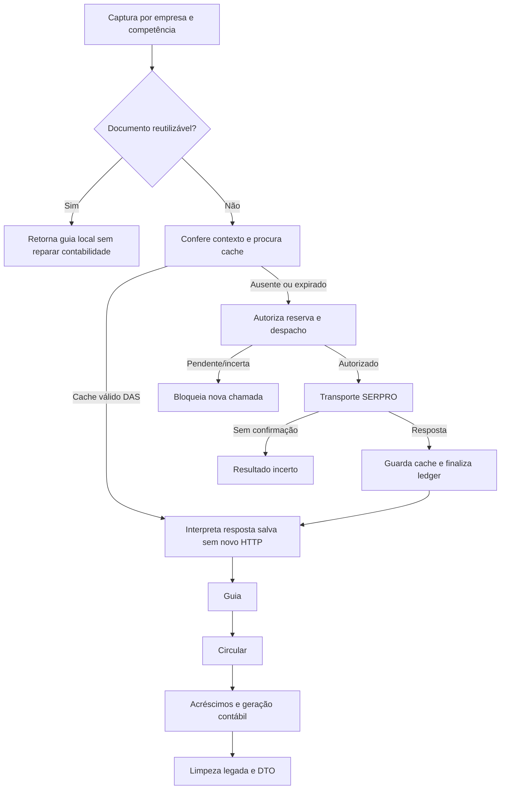

# DAS/SERPRO — recuperação e conciliação: caracterização 4.4.4

Base: `c305533c4ee7236ce4f6c668d7ad4dbb47c88dfb` (PR #280). Documento descritivo e proposta futura, não autorização operacional. Nenhuma rotina de recuperação, retentativa, reparação ou alteração de estado produtivo foi implementada. Registros criados nos testes pertencem exclusivamente ao PostgreSQL descartável. Complementa a [caracterização 4.4](serpro-das-caracterizacao-44.md) e o [ciclo de guias](ciclo-operacional-guias.md).

## Vocabulário e alcance

**Confirmado** significa somente o fato explicitamente comprovado (por exemplo, documento local persistido), não sucesso fiscal/contábil global. **Parcial** identifica etapas persistidas com outras ausentes ou recusadas. **Incerto** significa que não se conhece o resultado externo. **Bloqueado** indica uma guarda atual. **Não verificável** indica insuficiência de evidência para a conclusão pretendida. Um cenário pode combinar classificações de dimensões distintas.

Fiscal interpreta o provedor; Guias controla identidade/revisão documental; Contabilidade controla provisões, razão, fechamento e baixa; Operações coordena processamento; infraestrutura mantém transporte, reservas/cache e persistência. A circular é compartilhada por campos: captura conserva fatos fiscais e Contabilidade conserva os estados/resultados contábeis. A distribuição de adaptadores da 4.4.3 não foi alterada. Comunicação não ganha confirmação de entrega, cobrança ou pagamento por estado fiscal inconclusivo.

## Matriz das evidências existentes

Caminhos abaixo relativos a `apps/api/src/`; modelos em [schema.prisma](../../apps/api/prisma/schema.prisma). “Sem TTL identificado” não promete retenção eterna, backup ou validade externa.

| Evidência e origem | Dono / identidade | Estado e validade | Consumidor e limite |
| --- | --- | --- | --- |
| SerproChamada; application/fiscal/serpro/SerproCallGuard.js | Infraestrutura; ID, assinatura SHA-256 de payload canônico + rota, CNPJ/empresa, serviço, competência/acaoId quando presentes | reservada, incerta, ok, erro, abortadas/recusadas; reservada/incerta sem expiração automática | Guard/orçamento; não prova faturamento nem sucesso fiscal. Lock global 73517001 em ReadCommitted serializa autorização. |
| AppSetting serpro_dispatch:<reservaId>; autorizarDespacho | Infraestrutura; reserva/empresa e authorizedAt | Marcador local de despacho, sem TTL de resolução | Revalida políticas/pausas/contexto e impede segundo despacho; não é recibo externo nem nova consulta da procuração. |
| SerproRespostaCache; SerproRespostaCache.js | Infraestrutura; SHA-256 envelope canônico + rota | JSON HTTP 200 dos serviços admitidos; TTL uma hora; expiração lógica e limpeza best-effort | HttpClient pode reaproveitar resposta; conteúdo ainda precisa interpretação. atualizar invalida cache documental antes da tentativa. |
| FiscalExecutionLog; FiscalManualRunService | Fiscal/Operações; ID, empresa, competência, ação, autor | running/completed/failed/skipped, contadores/erro; sem TTL identificado | Painéis/execução; completed não exige accounting.ok. |
| AppSetting serpro_pgdasd_log:<tempo>:<UUID>; SerproExecutionLogService | Operações; execução local | Resumo do worker; sem TTL fiscal | Não existe model Prisma SerproExecutionLog; resumo não prova contabilização ou entrega. |
| Guide; GuideService/atualizarGuiaComEvidencia | Guias; ID, empresa/competência, sourceFileId, número, hash/PDF, vínculos | Sem TTL; CAS updatedAt até quatro tentativas | Documento/projeções; revisão e bytes não provam pagamento/entrega. Atualização preserva campos de pagamento/prova. |
| Revisão documental; versaoPagamentoGuia/revisaoDocumentoGuia | Guias/Comunicação; revisão derivada do documento e dados relevantes, incluindo vencimento | Válida para a revisão correspondente | Recibos/tentativas verificam revisão/hash. Distinta do token SHA-256 da correção de valor. |
| CompanyMonthlyCircular | Fatos fiscais e Contabilidade, por campo; empresa + competência | Valores, rawPayload/metadata, acréscimos e fechamento; sem TTL identificado | Captura, gerador, Operações. Pode existir sem provisão; retorno da captura precede split/gerador. |
| AccountingEntry e linhas; AccountingEntryGeneratorService | Contabilidade; empresa/competência, eventType, circular e sourceGuide quando existente | Provisões/baixas/status, transação Serializable própria | Razão/fechamento; DAS legado pode não ter sourceGuideId. Fonte GUIA preserva regra de recálculo; lista vazia não comprova conciliação. |
| Parcelamentos e guias vinculadas | Guias/Contabilidade; contrato, parcela, parcelamentoId e vínculos | Identidade preservada, sem TTL documental identificado | whereDasSalvo exclui vínculo/prefixo PARC-; limpeza usa WHERE_GUIA_SEM_PARCELAMENTO. Não confundir parcela com DAS mensal. |
| Pagamento/comprovante; ConfirmacaoPagamentoClienteService | Guias/Contabilidade; guia, empresa e versão documental | AppSetting contabil:cliente:confirmacao: append-only; estado separado contabil:cliente:estado: | Declaração/prova não substitui baixa contábil; atualização documental e limpeza têm consequências distintas. |
| RegistroRecalculoGuia | Guias; Guide.extracted.recalculoGuia e identidade | Autor/data, antes/depois, CAS; GUIA_ALTERADA em conflito | Auditoria/projeção; não confirma alteração do razão. Associação contábil sem vínculo direto exige identidade não ambígua. |
| Worker/GuideLockService | Operações; serpro_pgdasd_capture_lock | Lease de 30 min, renovação/CAS e assertActive | Coordena execução local; expiração não resolve reserva fiscal. Captura/sync atuais usam somenteDocumentos. |
| SerproProcurationService | Fiscal; mesmo contribuinte/procurador e evidência de vigência/poderes | Reuso de evidência por menos de 24h, conforme condições atuais | Worker exige ATIVA/PGDAS antes da seleção; não elimina revogação posterior. Tentativa e evidência são distintas. |

## Mapa de reservas, cache e documentos

A fixture de cache com reserva incerta constrói explicitamente ambos os registros; não afirma que um timeout produza resposta salva. Os testes do HttpClient com contagem de guias zero não invocam o escritor documental; persistência documental é coberta separadamente em 4.4.2/4.4.3. O reinício ensaiado é desconexão/nova instância Prisma, não crash/restart do worker inteiro.

O diagrama simplifica o sucesso do transporte; falhas ao guardar cache ou finalizar ledger interrompem o caminho e conservam evidência parcial. Cache e ledger não formam transação única com documentos. Para DAS, cache válido é lido **antes** da guarda de reserva e pode existir com reserva pendente: reprocessamento local não concilia a reserva. O ramo de simulação TRANSDECLARACAO11 tem verificações próprias e não deve ser generalizado para GERARDAS12/GERARDASCOBRANCA17.

A reutilização documental também não exige origem SERPRO: `whereDasSalvo` admite upload processado com PDF, mesma empresa/competência/tipo e sem vínculo de parcela. Nova tentativa explícita, com atualizar/existingGuideId/data de consolidação, preserva regras atuais de bypass da reutilização e invalidação de cache; não é recuperação automaticamente segura.

## Matriz de falhas e resultados parciais

T = caracterização por doubles; PG = persistência real em PostgreSQL descartável; I = inspeção. A tabela aponta contratos/testes, não ocorrências comprovadas em produção. Resultados de execução estão no registro e no PR.

| # | Cenário | Classificação e comportamento atual | Evidência de cobertura |
| --- | --- | --- | --- |
| 1 | Timeout sem confirmação | Incerto externo; SERPRO_TIMEOUT e ledger incerta, sem autorização implícita de retry | T: serproHttpReserva e caracterização 444; PG: reserva persistente 444 |
| 2 | Incerta após reinício | Bloqueado para nova chamada; persistência sobrevive nova conexão, inclusive forçar | PG: 444; reinício simulado por nova instância/conexão, não crash real do worker |
| 3 | Cache sem guia | Parcial; pode reprocessar resposta durante TTL sem HTTP, não prova guia/provisão nem resolve ledger | T: captura com writer simulado; PG: cache/ledger reais sem invocar escritor; respostasReutilizadas complementa |
| 4 | Guia sem circular | Parcial; upsert falha após documento, sem compensação | PG: dasContabilidade443 e dasPersistencia44 |
| 5 | Circular sem provisão | Parcial; fechamento/falha/ausência de regra não se distinguem por mera existência da circular | PG: dasContabilidade443; T: retorno contábil vazio |
| 6 | Falha contábil após documento | Parcial; accounting.ok:false e limpeza posterior podem coexistir | PG/T: dasContabilidade443 e dasCaracterizacao44 |
| 7 | Guia reutilizada | Documento local confirmado; contabilidade não verificável pelo DTO vazio; sem reparação | PG: dasContabilidade443; T: capturaReutilizacao |
| 8 | Guia paga substituída/removida | Parcial e potencialmente destrutivo; update preserva pagamento, mas limpeza não filtra PAID | PG: dasDocumento442; não executar limpeza real |
| 9 | Revisão alterada na reemissão | Documento local confirmado, evidências anteriores exigem comparação de revisão | PG: dasDocumento442/vigenciaDocumento41; T: registroRecalculoGuia |
| 10 | Resposta duplicada/simultânea | Bloqueado ou parcial por fronteira; reserva serializada, CAS/unicidade/Serializable locais; sem atomicidade global | PG: 444 reservas e 442 CAS/P2002; conflitos contábeis injetados em 443 não são teste de todo fluxo simultâneo |
| 11 | Procuração revogada depois da seleção | Não verificável com evidência externa antiga; janela atual não eliminada | T: serproPgdasdAgenda simula janela; I: despacho não reconsulta procuração. Resultado real do provedor não testado |
| 12 | Competência fechada | Bloqueado contábil, parcial global: documento/circular/acréscimos podem persistir; mes_fechado sem provisão | PG: dasContabilidade443 |
| 13 | Negativo fiscal/ausência legítima | Confirmado só no significado da resposta interpretada; erro/PDF ausente não prova ausência de obrigação | T: dasInterpretacao441, pgdasDocumentos, agenda; semDas exige extrato completo, total zero e ausência de número |
| 14 | Execução completed e contabilidade pendente | Parcial; completed/entriesGenerated=0 não comprovam conciliação | T: caracterização 444 de FiscalManualRunService; I: consumidores |

DAS normal e cobrança permanecem distintos; interpretação e valores legados não foram promovidos a novas regras definitivas. Não foi provada a segurança de repetir automaticamente nenhum cenário incerto.

## Operações, segurança e lacunas

`OperationsDocuments.completarDocumentosOperacao` relê artefatos e busca faltantes em modo documental. Guardas de reserva/política interrompem a operação composta; outras falhas ficam como documento não confirmado. `FiscalManualRunService` pode registrar completed com accounting.ok:false. O worker atual captura/sincroniza somente documentos e trata NOT_FOUND sem declaração como aguardando conferência, não como falha técnica a repetir. A descrição histórica em workers/CLAUDE.md sobre gerar lançamentos não representa essas chamadas atuais; não foi editada nesta entrega.

Proteção #275 preservada: rotas antigas de liberação/revogação usam preflight canônico por empresa, vínculo ativo e papel ACCOUNTANT, mantendo exceção admin vigente. Lote moderno usa empresasVisiveis com política global admin/contador distinta. Não houve harmonização. Procuração, autorização do usuário e pausa operacional são dimensões separadas. Testes não homologam autorização no provedor externo.

Lacunas identificadas:
- Não há prova universal de conclusão que una reserva, resposta, revisão documental e provisão.
- Não há resolução automática segura de reservas incertas por prazo; cache não prova faturamento nem encerra ledger.
- Guia reutilizável pode impedir nova geração contábil mesmo após falha anterior.
- Logs operacionais e contadores não distinguem toda pendência contábil.
- Ausência de sourceGuideId e múltiplas revisões podem impedir associação inequívoca.
- Limpeza legada de duplicatas pagas pode remover evidências locais; reconstituição não deve ser presumida.
- Revogação externa da procuração pode ocorrer após a seleção.
- Nenhuma inspeção de dados/provedor reais foi feita; incidência e recuperabilidade reais permanecem não verificáveis nesta entrega.

## Plano proposto — não implementado

1. **Leitura de conciliação:** construir projeção somente leitura por empresa/competência/serviço/documento/revisão, exibindo evidências, datas e lacunas separadas. Aprovar campos, permissões e significado antes de implementar; nenhuma ação fiscal ou escrita implícita.
2. **Recuperação documental local:** avaliar separadamente reaplicação de resposta já salva e válida. Exigir identidade/versão, autorização atual, plano de alterações, CAS e testes de repetição sem novas chamadas. Não habilitar com base apenas em cache ou ausência de guia.
3. **Conferência contábil:** preparar proposta por Contabilidade, com comparação da provisão/linhas, pagamentos, exportação e fechamento. Aprovação humana específica antes de qualquer escrita; transação/auditoria e repetição precisam de contrato próprio. Documento não autoriza baixar ou reabrir competência.
4. **Reservas incertas:** definir evidência externa suficiente, responsável e decisão auditável. Nenhuma expiração, desbloqueio, alteração manual de status ou nova consulta está autorizada. Consulta externa que gere custo/ato exige autorização própria.
5. **Duplicatas e histórico:** investigar preservação/restauração de evidências antes de propor correção funcional da limpeza. Não recriar comprovantes, vínculos ou estados de pagamento por inferência.

Critérios mínimos de uma futura operação: empresa e revisão inequívocas; autorização atual no servidor; procuração/poderes e período quando houver ato fiscal; ausência de resultado externo incerto não resolvido para novo despacho; fechamento/pagamentos respeitados; diff antes/depois e autoria; simulação com falhas em cada fronteira; idempotência comprovada; nenhum envio de Comunicação decorrente apenas de estado fiscal inconclusivo; plano de reversão que não prometa desfazer ato externo. Esses critérios são proposta sujeita a aprovação, não novas guardas já implementadas.

## Verificação e rollback

A entrega adiciona somente testes, documentação, índice e execução dos testes no workflow. Código produtivo, schema, migrations, HTTP, cache/TTL, locks/leases, idempotência, pagamentos e workers devem permanecer sem diff. Compare a base e candidata no verificador em diagnose; testes não criam licença para novos achados.

Rollback documental: reverter os commits desta caracterização (incluindo testes e sua inclusão no workflow), sem tocar dados, reservas ou arquivos de ambientes anteriores. Banco sintético é exclusivo; nenhum cluster antigo foi iniciado/alterado. Logs locais e resultados permanecem como evidência privada; o PR registra resultados e limitações sem conteúdo fiscal real.

Próximos incrementos exigem aprovação humana própria. Não integrar este PR nem iniciar recuperação/conciliação funcional automaticamente.
