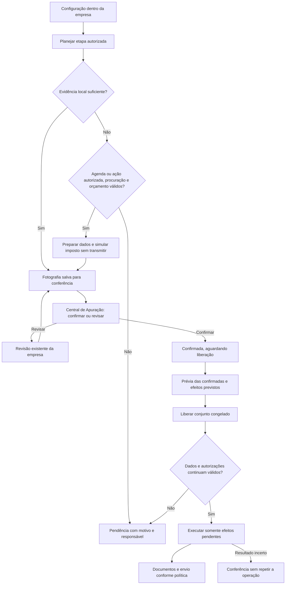

# Plano de implementação da Central de Operações

15/10/2026 · Planejamento revisado. Primeiro incremento local de navegação, status de empresas e seleção de consultas implementado; [escopo e validação da entrega](central-operacoes-etapa-1-2026-10-15.md). Aprovação/liberação e novo executor ainda não implementados.

Este documento complementa o [mapa de serviços e lacunas](mapa-automacao-empresa-guias-pagamentos-2026-10-15.md). Define navegação, contratos de API, persistência, consultas, falhas, migração e critérios de aceite. Três agentes fizeram revisões independentes de UI/UX, backend/dados e consultas/falhas. Os achados foram confrontados com o código, não com produção. Revisão de planejamento não substitui os testes de implementação.

**Decisão do usuário:** Operações fica ao lado do **Calendário** (a visão hoje chamada Agenda). A configuração de ativação de consultas pertence **ao contexto de cada empresa**. O painel global não terá botão para habilitar consultas da carteira. Confirmar e liberar apurações são ações distintas dessa configuração. **Correção de escopo durante a implementação:** a rotina de Operações é independente do Calendário e de suas obrigações. Sua fonte de acompanhamento é o status da tabela Empresas. Não ler/criar tarefas do Calendário, nem usar seus prazos para planejar operações. O Calendário está sendo alterado em paralelo e seus componentes permanecem intactos.

## 1. Furos encontrados e decisões que os fecham

| Achado | Risco | Decisão do plano |
| --- | --- | --- |
| Calendário é uma visão de `/companies`, não rota independente. | Criar navegação desconectada e perder contexto. | Acrescentar `operacoes` ao seletor existente, preservando `calendario` e `tabela`. |
| A Central atual executa transmissão em lote. | Botão Confirmar transmitir ou fechar empresa. | Nova aprovação operacional separada; Confirmar não chama lote, salvar fechamento ou transmissão. |
| Cálculo oficial e transmissão precisam de fronteira clara. | Gastar ou transmitir ao abrir a conferência. | Preparação autorizada simula com `indicadorTransmissao:false`; tabela lê fotografia salva; transmissão pendente somente após liberação. |
| Captura INSS consulta, emite, altera circular e remove outras guias. | Perder versões, alterar fechamento e repetir envio. | Adaptador documental aditivo; não conectar diretamente o serviço inteiro ao novo Fluxo. |
| Reuso INSS atual aceita apenas origem SERPRO. | Ignorar uploads válidos e pagar outra consulta. | Novo resolvedor documental aceita origens válidas, inclusive upload; identidade fiscal e revisão decidem suficiência. |
| Lote existente não persiste criação e itens atomicamente nem recupera despacho incerto com segurança. | Lote parcial, preso ou reexecutado após queda. | Liberação transacional, efeito único, tentativa persistida e recuperação por estado. Não reativar loop global antigo. |
| “Todas confirmadas” muda entre prévia e execução. | Incluir empresas que não estavam na decisão. | Prévia persiste conjunto e versões. Confirmadas posteriores entram no próximo lote. |
| Permissão de carteira é diferente entre rotas atuais. | Usuário agir em empresa sem vínculo autorizado. | Resolver único no novo módulo; `portalClientId` operacional; revalidar acesso em cada mutação e despacho. |
| Estado fiscal `confirmada` e `PAID` têm significados existentes. | Aprovação humana aparentar transmissão ou pagamento oficial. | Estados independentes de revisão/aprovação, fiscal, documento, envio e pagamento. |
| Intervalos de consulta podem virar retry automático. | Repetir custos e contrariar agenda salva. | Nenhuma falha, negativo, reinício ou cooldown vencido autoriza nova consulta. Preservar agenda explícita e ações autorizadas. |
| Retificação pode parecer transmissão comum. | Alterar declaração já entregue por liberação genérica. | Retificação fica fora do lote comum; requer intenção específica e confirmações já existentes. |

Evidências principais: `renderCompaniesHomePage.jsx`, `WorkspaceNavigation.jsx`, `useApuracao.js`, `apuracaoBatchWorker.js`, `ManualTaskService.js`, `requireFirmCompanyAccess.js`, `FechamentoService.js`, `PgdasSimulacaoService.js`, `SerproDctfwebService.js`, `reutilizarGuia.js`, `SerproCallGuard.js` e as instruções da raiz sobre agenda fiscal explícita.

## 2. Jornada completa e fronteiras de autorização



Cada efeito tem autorização própria. Habilitar preparação permite a simulação paga no horário salvo; não autoriza transmissão. Confirmar registra a decisão local. Liberar autoriza os efeitos exibidos na prévia, ainda sujeitos às pausas, acesso, procuração, disponibilidade e demais guardas. Uma liberação não liga rotina desativada nem ignora pausa.

Para empresas já **Apurado** por prova externa, não criar cálculo ou fechamento interno fictício, nem transmitir novamente. A conferência usa a evidência disponível; se for insuficiente, indica o que falta. Guias e extratos completos satisfazem suas etapas sem nova rede. Obter guia não é prova de entrega de declaração.

`calcularFechamento` já contém simulação oficial e reaproveitamento do cálculo salvo; `salvarFechamento` altera fechamento; `transmitirFechamento` reúne consulta de existência, transmissão e sincronização. Reutilizar por adaptadores com efeitos explícitos. A nova autorização não fabrica estado `fechada` para satisfazer o lote antigo: validar os pré-requisitos reais e conservar o fechamento existente. Se a rotina interna exigir fechamento ainda não realizado, expor essa pendência e encaminhar à ação atual, sem fechar silenciosamente.

## 3. Navegação e desenho das telas

### Rotas de interface

| Destino | Contrato proposto | Comportamento |
| --- | --- | --- |
| Calendário | `/companies?visao=calendario` | Mesma visão atual; não substituir eventos nem calendário. |
| Operações | `/companies?visao=operacoes&competencia=2026-09&dia=2026-10-15` | Novo modo na mesma navegação. Competência fiscal e dia operacional são campos diferentes. |
| Empresas | `/companies?visao=tabela` | Mantém lista, filtros e ações existentes. |
| Conferência | `/apuracao?modo=conferencia&competencia=2026-09` | Reaproveita Central de Apuração com nova aprovação; caminho legado permanece distinto durante migração. |
| Automação da empresa | `/companies/:companyId/automacao` | Destino implementado na primeira etapa. Contém ativação e exibe o horário salvo da rotina; nenhum toggle equivalente no painel global. |
| Revisão individual | Destino atual de Apuração gerado por `rotasDaEmpresa.js` | Preserva competência, retorno, filtros e posição da lista. Não inventar outro editor fiscal. |

O seletor `visao` e o destino Automação foram implementados na primeira etapa. As queries operacionais de dia/competência e a conferência continuam propostas para as próximas etapas. A URL explícita prevalece sobre memória da sessão. Sem query, preservar comportamento atual. Validar valores de query; modo inválido mostra destino seguro sem executar nada. Incluir voltar/avançar, recarregar e link direto nos testes. O rótulo Calendário refere-se à Agenda atual; eventual troca do texto visível deve manter o identificador `calendario`.

### Visão da página Operações

```text
Calendário   [Operações]   Empresas

Central de Operações          Competência: 09/2026
Situação: Operando            Atualizado às 10:32

Rotinas concluídas     Aguardando aprovação
Pendências de clientes Falhas de integração

Tarefas do dia · 15/10/2026
08:30  Empresa A  Conferir apuração       [Conferir]
09:00  Empresa B  Pró-labore externo      [Abrir tarefa]
10:00  Empresa C  Sem procuração válida   [Ver na empresa]
Sem horário: tarefas sem planejamento horário

Atrasadas de dias anteriores · por prazo original
```

Exemplo estrutural, sem representar empresas ou resultados reais. Indicadores abrem filtros e mantêm o escopo. Números não conhecidos aparecem como indisponíveis, nunca zero. Rotinas contam etapas concluídas; aprovação conta empresas/competências aguardando conferência; pendências e falhas contam itens abertos únicos. As futuras tarefas diárias serão persistidas pelo fluxo operacional independente, com horário próprio explicitamente configurado e identidade única por empresa/competência/etapa. Não importar ocorrências ou vencimentos do Calendário. A primeira etapa mostra o andamento por empresa, pelos mesmos status da tabela Empresas; ainda não oferece tarefas do dia nem estado de saúde do executor. Não somar indicadores como número de empresas.

Saúde operacional: **Operando**, **Parcialmente pausado**, **Pausado**, **Executor indisponível** ou **Situação indisponível**, com instante observado. Usar heartbeat e configuração efetiva. Queda de leitura conserva último dado datado, desabilita ações que dependam de atualidade e mostra aviso persistente.

### Conferência e liberação

```text
Conferir apurações · 09/2026
Empresa | Anexo e comparação | Faturamento | Imposto e origem | Ações
A       | III → III          | atual/ant.  | valor oficial    | Confirmar / Revisar
B       | III → V · motivo   | atual/ant.  | valor oficial    | Confirmar / Revisar
C       | Sem base anterior  | atual       | indisponível     | Ver pendência

Confirmadas nesta competência: N · Visíveis no filtro: M
[Liberar confirmadas (N)]
```

Anexo pode ser uma distribuição, não campo único. Comparar com a última evidência válida da competência anterior e registrar essa referência. Mesmo anexo não significa mesmo imposto. Causa desconhecida de mudança exige revisão e justificativa explícita, não texto automático inventado. Sem mês anterior não há falsa igualdade; a revisão atual ainda pode ser aprovada quando completa. Faturamento fiscal e receita bruta emitida não são intercambiáveis: cada valor informa origem, exclusões e composição. Imposto apurado é separado do valor da guia com juros/multa.

**Confirmar:** botão nomeado para a empresa; “Salvando confirmação…” durante gravação; só após aceite persistido muda para “Confirmada — aguardando liberação”. Bloquear somente a linha em gravação. Permitir desfazer confirmação antes da liberação, com versão e evento. Depois da liberação, pausar continuação é outra ação: não simular desfazer uma transmissão iniciada.

**Revisar:** abre tela existente da empresa. Preservar contexto de retorno. Mudança material invalida aprovação; sair do editor não confirma automaticamente. Erro de uma empresa não impede revisar outras.

**Liberar:** abrir prévia persistida com competência, lista de confirmadas, quantas estão fora do filtro, bloqueios e efeitos posteriores por empresa. A ação final é “Liberar N confirmadas”. O conjunto contém todas as confirmadas acessíveis da competência na hora da prévia, inclusive ocultas pelo filtro; novas confirmações posteriores ficam fora. A prévia expira em 10 minutos. Mudança global de escopo, competência, capacidade contratual ou tarifa que afete a decisão invalida a prévia inteira. Mudança de dados, política, acesso ou procuração de uma empresa bloqueia somente aquele item, preservando os demais. Após aceite: resultado por empresa, com liberadas, já liberadas, bloqueadas e em verificação; nunca sucesso geral que esconda falhas.

### Configuração dentro da empresa

Em Configurações → Automação: mostrar padrão e competência selecionada, origem efetiva e histórico. Grupos: preparação/simulação, transmissão após liberação, extrato/recibo, DAS, guia previdenciária, comunicação e pagamento. Exibir somente capacidades disponíveis; indisponível tem motivo.

Cada etapa apresenta modo, habilitação, última execução, próxima execução efetiva e condições. Pausas de consultas pagas, mensagens automáticas e automação completa são distintas. Alterar não dispara execução. A empresa opta explicitamente por cada rotina; ausência continua desabilitada. No primeiro incremento, exibir e reutilizar o horário global já salvo como “Horário da rotina”, sem criar agenda individual fictícia. Exceção de habilitação por competência não implica horário próprio.

Salvar exige prévia local de impacto e versão esperada. Mostrar “Salvo”, autor/data/revisão e próxima execução apenas quando confirmados. Não copiar automaticamente configurações de outra empresa. Uma pausa não interrompe um HTTP já autorizado, mas bloqueia os efeitos posteriores; isso aparece no resumo de impacto. A ação humana de liberar não contorna a pausa.

### Estados e acessibilidade

Carregando, vazio, parcial, desatualizado, sem acesso, salvando, conflito de versão, erro conhecido e resultado incerto têm apresentações próprias. Erro fica na linha/painel e histórico, não apenas em toast. Foco retorna ao gatilho após modal; teclado, leitor de tela e rótulos por empresa; estado não depende só de cor. Usar componentes e tokens atuais. Em celular, cartões equivalentes ou rolagem apenas da tabela; empresa, competência, imposto e ações nunca somem. Respostas antigas de outra competência não podem atualizar a tela atual.

## 4. Contratos de API

Prefixo real: `/firm`. Os endpoints abaixo são **propostos**; essa tabela unifica os nomes sugeridos pelos revisores. Não criar aliases paralelos para o mesmo efeito.

| Método e caminho após `/firm` | Entrada principal | Saída e efeito |
| --- | --- | --- |
| `GET /operacoes/resumo` | competência | Indicadores, saúde, `asOf`, dados indisponíveis. Leitura local. |
| `GET /operacoes/tarefas` | dia, competência opcional, filtros, cursor | Tarefas por horário, origem/ID, responsável, ação permitida e próximo cursor. |
| `GET /operacoes/apuracoes` | competência, situação, busca, cursor | Linhas de conferência com fontes, comparação, fingerprint e ações permitidas. |
| `GET /companies/:id/automacao` | competência opcional | Padrão, exceção, política efetiva, versão e agenda existente. |
| `POST /companies/:id/automacao/previa` | escopo, configuração proposta, versão | Impacto local, `previewId`, hash e validade; zero rede externa. |
| `PUT /companies/:id/automacao` | previewId, expectedRevision, requestId, motivo | Salva política e evento; 409 se contexto mudou. |
| `POST /companies/:id/operacoes/apuracoes/:competencia/confirmacao` | expectedFingerprint, requestId | Aprovação persistida, autor/data; sem cálculo/fechamento/HTTP. |
| `POST /companies/:id/operacoes/apuracoes/:competencia/revisao` | expectedFingerprint, motivo, responsável, prazo, requestId | Invalida aprovação e vincula tarefa de revisão única. |
| `POST /companies/:id/operacoes/apuracoes/:competencia/desconfirmacao` | approvalId, expectedRevision, requestId | Revoga aprovação ainda não liberada. Se liberada, 409 com ação de pausa. |
| `POST /operacoes/liberacoes/previa` | competência | Conjunto congelado de IDs/hashes, efeitos, bloqueios, validade e previewId. |
| `POST /operacoes/liberacoes` | previewId, requestId | 202 com releaseId e statusUrl após persistência; execução assíncrona, não no HTTP da liberação. |
| `GET /operacoes/liberacoes/:releaseId` | cursor opcional dos itens | Resultado persistido por empresa; parcial não é sucesso integral. |
| `GET /operacoes/requisicoes/:requestId` | escopo do ator autenticado | Recupera resultado de mutação após perda de resposta; não executa nada. |
| `GET /companies/:id/operacoes/historico` | competência, cursor | Eventos sanitizados e referências autorizadas. |
| `POST /companies/:id/operacoes/etapas/:stepId/reconciliacao` | modo local/consulta autorizada/evidência, expectedVersion, requestId, motivo | 202 para conferência, não repetição do efeito incerto; consulta paga exige todas as guardas. |
| `POST /companies/:id/operacoes/etapas/:stepId/solicitacoes` | ação explícita, prévia, expectedVersion, requestId | Solicita preparação, revalidação ou documento faltante; jamais genérico “retry”; não libera transmissão/retificação. |
| `POST /companies/:id/operacoes/pro-labore/:competencia/conclusao-externa` | referências de evidências existentes, revisão, requestId | Registra conclusão externa e reavalia dependências locais. Não transmite folha nem confirma DCTFWeb. |

Uploads continuam na ingestão atual; só referenciar arquivo já salvo e autorizado, nunca aceitar caminho livre enviado pelo cliente. Download reaproveita autorização da empresa e do documento; identificadores não concedem acesso.

DTO de conferência: `companyId`, `competencia`, `anexos[]`, `comparacaoAnterior {referencia, status, motivos[]}`, `faturamento {valor, origem}`, `imposto {valor, origem, calculoId}`, `fingerprint`, `approval`, `blockers[]`, `allowedActions[]`, `documentos`, `asOf`. Valores monetários em string decimal; indisponível é null com motivo. Cada motivo separa evidência, conclusão e referência.

Validar competência com mês real, IDs, enum, tamanho de motivo e escopo; nunca confiar em ator, custo, empresa do arquivo ou efeitos enviados pelo navegador. Paginação proposta padrão 50/máximo 100 com ordenação estável; contador global por consulta de agregação, não pelo tamanho da página. Prévia do lote considera conjunto completo autorizado, não só as primeiras 500 empresas. Busca pode ser parcial, aprovação não.

Leituras não alteram progresso nem planejam efeitos. Atualização local de status a cada 15 segundos enquanto painel visível, com pausa ao ocultar e recuo em falha; consultas de status são somente banco. Esse polling não substitui nem aciona agenda fiscal. Resultado de mutação incerto usa a mesma requestId até resolução, inclusive após recarregar. Recuperação de requestId retorna 200 para resultado salvo, 202 para requisição em processamento e 404 para chave desconhecida no escopo do ator; 404 não prova que nenhum trabalho esteja em voo. Pode-se reapresentar o mesmo comando local com a mesma chave/payload para resolver o aceite idempotente, nunca repetir HTTP fiscal ou criar outra chave para escapar da incerteza.

Rotas atuais de apuração, lote, fechamento, documentos, fluxo-carteira e envio permanecem. A nova exigência de aprovação/liberação vale para empresas e etapas explicitamente migradas. Fora desse escopo, preservar o comportamento atual. Dentro dele, todas as entradas que podem disputar um efeito aderem à mesma guarda. Não deixar botão legado contornar autorização nova; encaminhá-lo ao adaptador comum ou bloquear apenas o conflito com mensagem explícita.

## 5. Backend e responsabilidades

Novo módulo `apps/api/src/application/operacoes/`, evitando confusão com `application/fluxo`, que é fluxo de caixa financeiro. Router proposto `apps/api/src/routes/firm/operacoes.js`; configurar somente as rotas novas no router da firma.

| Serviço proposto | Responsabilidade | Reuso |
| --- | --- | --- |
| `OperationAccessService` | Escopo de leitura/mutação/despacho; vínculo ativo e papéis reais. | Middleware de acesso à empresa e identidade existente. |
| `AutomationPolicyService` | Resolver padrão/exceção, modo, pausas, revisionamento e impacto. | CompanyRotina e agenda em SerproRuntimeSettings. |
| `OperationProjectionService` | Resumo pelos status da tabela Empresas; posteriormente tarefas operacionais próprias e leitura de conferência. | Projeção `fluxoDaEmpresa`/FluxoCarteiraService já utilizada pela tabela; nenhuma leitura das tarefas ou obrigações do Calendário. |
| `AssessmentApprovalService` | Fingerprint, confirmar/revisar/desconfirmar e histórico. | Cálculo salvo, snapshot/evidências externas sem mutá-los. |
| `OperationReleaseService` | Prévia congelada e liberação transacional. | Contratos fiscais atuais por adaptador, não o executor antigo diretamente. |
| `OperationEffectService` | Unicidade, autorização final, posse, tentativas e reconciliação. | SerproChamada, EnvioGuiaTentativa, guarda de consumo e saída rastreada. |
| `PgdasOperationAdapter` | Preparação, entrega já comprovada, documentos faltantes e transmissão autorizada. | Simulação, FechamentoService e modo somenteDocumentos. |
| `InssDocumentAdapter` | Evidência local de qualquer origem, consulta/emissão documental autorizada e persistência aditiva. | Parsing/composição e chamadas específicas do SerproDctfwebService. |
| `OperationErrorPresenter` | Converter falha em código, mensagem, ação segura e referência de suporte. | Mapeadores existentes, sem expor corpo bruto do provedor. |

IDs de empresa são `portalClientId`; `Company.id` legado não é intercambiável. O schema não demonstra isolamento por `firmId` para estes ledgers: não inventar esse campo como segurança. Proposta de acesso novo: admin conforme privilégio global real; demais operadores com papel permitido **e** vínculo ativo à empresa. A implementação inventaria enums reais antes de codificar. Leitura não concede confirmar, liberar, alterar configuração ou resolver incerteza. Mesmo operador pode confirmar e liberar, pois dupla aprovação por pessoas diferentes não foi exigida; registrar ambas as ações.

## 6. Salvamento e modelo de dados

Tabelas aditivas propostas; nomes devem ser refletidos na migration e no contrato de domínio. Não substituir `Guide`, `ApuracaoSnapshot` ou os registros legados.

| Registro | Dados essenciais e restrições |
| --- | --- |
| `CompanyAutomationPolicy` | empresa, scopeKey (`PADRAO` ou `YYYY-MM`), etapa, modo/habilitação/pausas, revisão, ator, motivo. Unique empresa+scopeKey+etapa; evitar null em unique de padrão no PostgreSQL. |
| `WorkflowInstance` | empresa, competência, tipo de jornada, estado derivado, versão. Unique empresa+competência+tipo. |
| `WorkflowStep` | instância, chave estável, estado, dependências, bloqueio, evidência, tarefa/ocorrência vinculada, responsável/prazo, versão. Unique instância+chave. |
| `WorkflowApproval` | etapa, fingerprint, fotografia imutável, calculoId/evidência oficial, autor/data, revogação/motivo. Apenas uma aprovação vigente da mesma revisão, com restrição transacional/índice apropriado. |
| `WorkflowPreview` | tipo, ator, conjunto de candidatos e efeitos, hash, policyVersions, criado/expiraEm. Imutável e associado à requestId da ação final. |
| `WorkflowRelease` e `WorkflowReleaseItem` | ator/requestId únicos, payloadHash, previewId, empresa/approval/fingerprint por item, resultado e bloqueio. Nenhum item sem lote persistido. |
| `WorkflowEffect` | businessKey única, empresa/competência/tipo/revisão, autorização, policyRevision, executor, estado, lease/fencing token, próxima ação. Serve também como outbox durável; não duplicar tabela se cumprir as garantias. |
| `WorkflowAttempt` e `WorkflowEvent` | Tentativas/eventos append-only; efeito, tempos, traceId, resultado seguro, referência SerproChamada/EnvioGuiaTentativa. Eventos não apagam estados anteriores. |
| `OperationRequest` | ator+requestId única, tipo, payloadHash, recurso/resultados; recuperação de confirmação/política/liberação após queda de conexão. Pode ser incorporada à entidade quando preservar o contrato único. |

Fingerprint material inclui empresa/competência, cálculo e versão do motor quando disponível, bases fiscais/classificações, anexos, RBT12/folha pertinentes, imposto e referência da evidência oficial. Não usar apenas `updatedAt`: progresso não é alteração fiscal. A comparação anterior tem referência própria; se ela sustentou a aprovação e foi retificada, marcar comparação/decisão afetada para revalidação. Hash e fotografia são produzidos pelo servidor, nunca aceitos como verdade do frontend.

Referências a PDFs apontam para armazenamento autorizado existente. Não salvar binários em eventos/logs. Persistir upload com estágio pendente, validar conteúdo e só então ativar documento/revisão; falha de banco não torna arquivo utilizável. Arquivos órfãos entram em limpeza controlada após retenção; não apagar arquivos referenciados ou histórico. Revisões imutáveis de guia entram antes de ativar substituição/recálculo automatizado no novo Fluxo.

### Chaves de negócio obrigatórias

Transmissão original: empresa operacional + CNPJ vinculado + competência + obrigação + ORIGINAL. Não incluir releaseId, usuário, executor, template ou fingerprint: mudar cálculo não autoriza segunda transmissão original. O fingerprint condiciona a autorização, não a identidade do efeito. Retificação tem identidade específica de intenção/conteúdo e referência à declaração anterior, fora do lote comum. Mudança cadastral de CNPJ invalida o vínculo operacional e exige revisão, não recria automaticamente a obrigação.

Simulação: empresa + competência + fingerprint material + serviço; nova simulação exige nova base ou ação autorizada de recuperação, não apenas novo lote. Documento: empresa + competência + identidade fiscal + revisão + tipo documental; quando ainda não há número, usar a chave da obrigação e tipo a recuperar, conciliando o número devolvido atomicamente. Envio: documento lógico + revisão + finalidade + canal + identidade vigente do destinatário. Reenvio legítimo é nova intenção explícita ligada à anterior. Templates/executores diferentes não mudam a identidade de um envio equivalente. Horário agendado e requestId identificam disparo/aceite, nunca substituem a chave do efeito.

### Transações e concorrência

1. **Confirmar:** resolver escopo; lock/CAS de empresa+competência; recalcular fingerprint local; comparar versão esperada; salvar request, aprovação e evento na mesma transação. Zero HTTP.
2. **Liberar:** validar prévia/ator/validade; congelamento já existente; gravar lote e itens atomicamente. Revalidar cada candidato, registrar bloqueados e reservar efeitos elegíveis de forma única. Um item bloqueado não desaparece nem reverte empresas válidas. Nenhum despacho antes do commit.
3. **Despachar:** adquirir posse com lease e fencing token; revalidar dependências, política, aprovação, acesso, procuração, documento/pagamento quando pertinente. A autorização final faz CAS sobre versões material, de aprovação, de política e de acesso. Todos os escritores relevantes — inclusive alterações legadas de notas, classificação, folha, confirmação/desconfirmação, pagamento e revogação de vínculo — atualizam suas versões atomicamente e participam do protocolo de lock/CAS. E0 inventaria esses escritores; sem cobertura, não ativar o efeito. Registrar `DISPATCH_AUTHORIZED` antes da rede; encerrar transação; enviar. Pausa ou mudança posterior a essa autorização trata o efeito como em voo, mesmo que o HTTP esteja prestes a iniciar, e impede os próximos.
4. **Concluir:** persistir resposta/protocolo e eventos com token da tentativa. Worker antigo sem posse não pode sobrescrever resultado novo. Distinguir sucesso fiscal de sucesso do armazenamento de PDF e do envio ao cliente.
5. **Queda:** item `NOT_STARTED` pode retomar processamento local se a autorização seguir válida. Consulta automática cujo horário salvo passou não ganha autorização por reinício: não há catchup. Continuação de lote manual já aceito usa a autorização própria registrada, sua validade e guardas. `DISPATCH_AUTHORIZED`/`IN_FLIGHT` sem resultado é `UNKNOWN`, não volta à fila por lease vencida. Reconciliar antes de permitir nova execução.
6. **Reserva monetária:** tentativa incerta mantém reserva; tempo não prova ausência de custo. Reserva de quota e autorização do efeito devem ser vinculadas antes do dispatch; falha entre as duas etapas bloqueia a rede e exige recuperação local.

Não manter transação aberta durante autenticação remota/HTTP. Rechecagem após autenticação evita que o intervalo deixe passar pausa anterior à autorização final. Não prometer atomicidade entre banco e provedor: resultado incerto é parte explícita do domínio.

## 7. Consultas, documentos e pró-labore

Ordem de decisão: acesso → capacidade/política → evidência local → necessidade concreta → habilitação e agenda/ação autorizada → procuração do serviço → tarifa/orçamento → reserva → autorização final → provedor. Pausa de consultas não bloqueia leitura e aproveitamento local. Cache HTTP válido é complemento; documento válido armazenado não expira só porque o cache HTTP expirou.

| Necessidade | Reutilização | Efeito externo permitido |
| --- | --- | --- |
| Apuração já comprovada e documentos completos | Evidência oficial + extrato/recibo + DAS válido/dispensa aplicável. | Nenhum para essa etapa. |
| Imposto para conferir | Simulação salva compatível com fingerprint. | Simulação sem transmissão, quando explicitamente autorizada. |
| Falta extrato/recibo | Documentos/histórico/resposta salva primeiro. | Apenas consulta correspondente; não transmitir ou buscar DAS já existente. |
| Falta DAS | Guia válida de qualquer origem e mesma identidade fiscal. | Recuperação/geração explicitamente identificada, somente se necessária e autorizada. |
| Procuração desatualizada | Registro com identidade, escopo, vigência e idade suficientes. | Revalidação específica, separada da busca fiscal e sem cadeia automática não autorizada. |
| Guia INSS manual válida | Mesmo CNPJ/competência, composição previdenciária, arquivo e validação. | Nenhum. |
| Pró-labore externo incompleto | Tarefa com responsável/prazo e evidência. | Nenhum para calcular/transmitir folha neste projeto. |
| Pró-labore concluído, guia ausente | Evidência externa e busca local. | Consultar declaração e, se necessário, emitir/recuperar guia como efeitos distintos e identificados. |
| Retificação suspeita | Comparação do histórico disponível. | Conferência explícita; não retransmitir/retificar pelo lote comum. |

A ativação paga fica na empresa e respeita o horário de rotina já salvo. Liberar uma continuação manual explicitamente apresentada pode autorizar os efeitos daquele lote; não equivale a criar agenda recorrente. Falhas e negativos não criam novos horários, retries ou catchup. Um disparo manual passa pelas mesmas pausas e limites; nenhum parâmetro `forcar` contorna a política.

Para INSS, o adaptador documental deve impedir a limpeza de guias anteriores e as alterações não solicitadas de circular, acréscimos e fechamento presentes no serviço atual. Identidade do documento considera número oficial, empresa, competência, composição e revisão; hash de bytes sozinho não detecta PDF equivalente. Não transformar um DARF misto em duas guias cobradas; validar a composição e manter um documento lógico. Se não houver prova suficiente, revisão humana.

Guia válida e envio dependem de liberação própria de documento e consentimento do destinatário, não apenas da liberação da apuração. Padrão de implantação conserva o envio atual. A opção futura de aguardar pacote DAS+INSS ou enviar cada documento pronto será configuração explícita por empresa; não bloquear DAS automaticamente por INSS faltante nem enviar documentos novos automaticamente ao migrar.

Consumo: preservar `SerproChamada` e o bloqueio de reservas incertas; ampliar para tarifa conhecida em micros/decimal por contrato e produto antes de habilitar novos efeitos pagos automatizados. O orçamento cadastral existente é padrão reutilizável, não cobertura de todo SERPRO. Não apresentar estimativa desconhecida como gratuita. Uma mudança de tarifa relevante invalida a prévia de custo/autorização que dela depende.

## 8. Estados e tratamento de erros

Estados independentes:

- Aprovação: `PENDING`, `IN_REVIEW`, `CONFIRMED`, `INVALIDATED`, `RELEASED`.
- Efeito: `NOT_STARTED`, `BLOCKED`, `DISPATCH_AUTHORIZED`, `IN_FLIGHT`, `SUCCEEDED`, `FAILED_KNOWN`, `UNKNOWN`, `CANCELLED_BEFORE_DISPATCH`.
- Documento: ausente, em validação, válido, em revisão, substituído; sempre com referência à revisão.
- Fiscal: preservar os estados existentes e **Apurado** quando comprovado. PDF ausente não desfaz transmissão.
- Comunicação e pagamento: manter estados próprios; informação do cliente suspende cobrança, não inventa confirmação oficial.

`FAILED_KNOWN` exige conhecimento de que o efeito não ocorreu, não apenas HTTP 500. Falha de transporte posterior ao envio pode ser `UNKNOWN` mesmo com erro. No lote, apresentar agregado parcial e resultados individuais, nunca converter `completed` em sucesso de todas.

Envelope de erro proposto:

```json
{
  "ok": false,
  "error": {
    "code": "APPROVAL_STALE",
    "category": "CONFLICT",
    "message": "Os dados mudaram desde sua conferência. Revise e confirme novamente.",
    "nextAction": "OPEN_REVIEW",
    "retryAllowed": false,
    "operationId": "identificador-da-operacao",
    "traceId": "codigo-de-atendimento"
  }
}
```

`retryAllowed` significa possibilidade de solicitar nova avaliação autorizada, nunca permissão para retry automático do cliente. Metadados da empresa/etapa só retornam dentro do escopo autorizado. Sem stack, token, certificado, payload fiscal bruto ou dados de outra empresa. 404 para recurso fora de escopo; 403 para ação vedada sobre recurso visível; 409 para conflito; 422 para dados inválidos; 503 para indisponibilidade. Operação aceita retorna 202 e seu recurso continua mostrando estados incertos/pendentes, sem fingir falha de aceite.

| Situação | Retorno ao usuário | Ação e repetição |
| --- | --- | --- |
| Procuração ausente/vencida/escopo inválido | “Não consultamos: procuração válida para este serviço não confirmada.” | Ver procuração dentro da empresa ou anexar documento; sem retry. |
| Procuração desatualizada | “A procuração precisa ser revalidada antes da busca.” | Revalidação autorizada separadamente. |
| Pausa na empresa | “Esta etapa está pausada nas configurações da empresa.” | Ver configuração; leitura local continua. |
| Documento completo | “Documento já disponível; nenhuma consulta necessária.” | Abrir documento salvo. |
| Retorno válido sem declaração | “A declaração não foi localizada nesta consulta.” | Mostrar data; registrar conclusão externa/conferir antes de nova solicitação. |
| Falha técnica do provedor | “O serviço não respondeu corretamente. Isso não indica falta de entrega.” | Preservar evidências; sem retry automático; classificar incerteza conforme despacho. |
| Autenticação falhou antes do efeito | “Não conseguimos autenticar a integração. A operação fiscal não foi enviada.” | Corrigir integração; só afirmar não enviada quando comprovado. |
| Timeout após despacho | “A operação foi iniciada, mas o resultado não foi confirmado. Uma nova execução está bloqueada.” | Conferir tentativa; não repetir. |
| Retorno recebido, gravação falhou | “Não foi possível registrar o resultado com segurança. A repetição está bloqueada.” | Recuperar resposta/evidência e reconciliar. |
| Transmissão comprovada, PDF falhou | “Apurado. Falta salvar o extrato ou a guia.” | Reprocessar resposta local; somente documento faltante se nova chamada for necessária/autorizada. |
| Simulação anterior sem cache recuperável | “Já houve uma consulta, mas o resultado salvo não está disponível para conferência.” | Recuperar snapshot ou conciliar tentativa; nenhum botão genérico Tentar novamente. |
| Upload inválido ou divergente | “O documento precisa de revisão: empresa, competência ou conteúdo não conferem.” | Manter em revisão, sem envio/contabilização automática. |
| DARF não previdenciário/misto | “Confira a composição: o documento não comprova sozinho a guia previdenciária esperada.” | Revisar classificação, sem duplicar guia. |
| Dados mudaram | “Os dados mudaram desde sua conferência. Revise e confirme novamente.” | Invalidar aprovação afetada. |
| Prévia venceu ou mudou | “A lista de liberação precisa ser atualizada.” | Nova prévia local, sem iniciar efeitos. |
| Lote parcial | “8 empresas liberadas; 2 continuam bloqueadas.” | Motivo em cada item; número ilustrativo, preenchido do resultado real. |
| Resposta de salvar/liberar se perdeu | “Não foi possível confirmar o resultado. Consulte o andamento desta operação.” | Consultar mesma requestId; não trocar chave nem desfazer sucesso já persistido. |
| Tarifa/orçamento indisponível | “A consulta não foi iniciada: orçamento ou tarifa indisponível.” | Corrigir configuração autorizada; documentos salvos continuam disponíveis. |
| Acesso revogado | “A execução foi bloqueada porque seu acesso mudou.” | Responsável autorizado reassume, sem herdar autorização indevida. |
| Falha na leitura do painel | “Não foi possível atualizar. Última informação às …” | Atualizar leitura local; indisponibilidade não vira zero. |
| Banco indisponível antes de autorizar | “Não foi possível salvar. Nenhuma nova execução foi autorizada.” | Somente quando a ausência de commit/dispatch é conhecida; senão consultar requestId. |

Reconciliação é uma operação auditada com evidência, motivo, ator e resultado. Suporte não pode marcar sucesso ou liberar consumo só para desbloquear fila. Se consulta ao provedor for necessária para resolver incerteza, ela própria é efeito pago autorizado e rastreado. Declaração original existente não prova transmissão de retificadora.

## 9. Arquivos e integrações a modificar

| Área | Alvos previstos | Limite |
| --- | --- | --- |
| Navegação | `WorkspaceNavigation.jsx`, `useManageAuthSession.js`, `App.jsx`, `rotasDaEmpresa.js`, `renderCompaniesHomePage.jsx` | Registrar modo/queries/rota empresa; preservar shell, histórico e calendário. Confirmar localização de cada arquivo no patch. |
| Nova visão | `apps/web/src/features/operacoes/` com página, hooks, resumo, tarefas e detalhe de resultado | Apenas leitura/agregação na montagem. |
| Conferência | `features/apuracao/pages/renderApuracaoPage.jsx`, hooks e componentes de revisão existentes | Novo modo e aprovação operacional; lote legado distinto e protegido. |
| Configuração empresa | Feature de configurações e nova seção Automação | Único local de ativação de consultas. |
| API cliente | Métodos novos no cliente HTTP e mocks de teste existentes | Separar ler, confirmar, liberar, reconciliar. |
| Backend | Router/serviços Operações, adaptadores PGDAS/INSS, guarda de autorização | Não alterar fórmulas fiscais nem fechamento por conveniência. |
| Banco | Migration aditiva e índices de unicidade/consulta | Sem drop/reclassificação em massa; backfill idempotente e auditável. |
| Executor | Worker de efeitos autorizado integrado ao agendador atual | Não reativar loop fiscal antigo nem consumir lotes legados automaticamente. |

Fluxo novo não deve deixar o legado sem proteção: antes de ativar um tipo de efeito, mapear todas as rotas, jobs, botões e consumidores que o executam. Adaptar todos à mesma chave/guarda e demonstrar exclusão em teste. Se alguma entrada não puder aderir, não ativar o novo executor daquele efeito ainda.

## 10. Migração, entrega e reversão

| Entrega | Resultado revisável | Condição para avançar |
| --- | --- | --- |
| E0 Contratos e caracterização | Rotas reais, inventário completo de entradas, permissões, fingerprints e fixtures. | Nenhum efeito crítico sem dono/guarda definidos; resolver consumidores de PAID e adaptador INSS. |
| E1 Persistência e política | Tabelas, requests, configuração na empresa, prévia e aprovação local. | Confirmação/política sem HTTP; concorrência PostgreSQL aprovada. Sem ligar novas consultas. |
| E2 UI de leitura e conferência | Operações junto ao Calendário apenas na navegação; status da tabela Empresas, tarefas operacionais independentes, conferência, resultado de lote. | UX dos estados e contexto validada; backend pode simular executor, sem efeito externo. |
| E3 Liberação e PGDAS | Prévia congelada, efeito único, adaptadores e integração de guardas legadas. | Custo/pausa/acesso/procuração/retificação protegidos; observação sem rede primeiro. |
| E4 Pró-labore e INSS | Tarefa externa, upload reutilizado, adaptador documental aditivo. | Preservar circular/fechamento/guias anteriores/pagamentos; sem remoções destrutivas. |
| E5 Revisões, comunicação e pagamento | Identidade/revisão, intenções, informação vs confirmação e conferência humana. | Migração de consumidores antigos testada; callbacks e comprovante antigo não causam nova cobrança. |
| E6 Ativação gradual | Empresas/etapas explicitamente configuradas e acompanhamento. | Evidência de aceite completa para o escopo ativado, backup/migration verificados e plano de reversão ensaiado. |

Inicialização preserva habilitações existentes e não cria autorizações humanas retroativas. Features novas ficam desligadas até ativação explícita. Modo de observação só lê/reprocessa dados locais. API e schema entram antes da interface; workers novos continuam desabilitados durante migrations/backfill.

Reversão desabilita novas autorizações e preserva leitura/histórico. Não apaga reservas, incertezas ou eventos, não entrega automaticamente os mesmos efeitos ao legado e não “destransmite” operações. Efeitos em voo são reconciliados; retomada requer posse definida. Alterações aditivas permanecem compatíveis com leitores legados até migração concluída.

## 11. Verificação e critérios de pronto

Os 32 critérios da especificação continuam válidos, com os complementos abaixo. Ensaios em PostgreSQL isolado, 50 empresas sintéticas e transportes simulados; nunca usar declaração, mensagem ou consulta fiscal real como teste.

- Confirmar, desconfirmar, salvar política, abrir tela e ler progresso fazem zero chamadas externas.
- Preparação usa simulação sem transmissão; no escopo explicitamente migrado, transmissão anterior à liberação é impossível, inclusive por caminho legado concorrente. Fora dele, o fluxo atual permanece.
- Mesmo requestId retorna mesmo resultado; payload diferente com a mesma chave gera conflito. Perda de resposta não duplica lote.
- Prévia não inclui confirmações posteriores; edição entre prévia/confirmar/liberar/dispatch bloqueia só os itens afetados.
- Duas liberações, inclusive com cálculos diferentes, e dois executores concorrentes produzem uma transmissão original; acesso revogado, mudança material e pausa durante autenticação impedem autorização final.
- Queda antes/depois de cada commit/despacho e resposta recebida sem persistência: nunca replay de efeito incerto.
- Upload válido INSS/DAS, extrato local, declaração zerada dispensada e documentos equivalentes com bytes distintos não geram consultas/envios duplicados.
- INSS preserva histórico/circular/fechamento/pagamento; DARF misto e parcela não viram outra cobrança.
- Sucesso fiscal com falha de PDF mantém Apurado; retificação antiga não satisfaz retificação nova.
- Falha técnica nunca vira declaração ausente ou pagamento não confirmado. Informação do cliente suspende cobrança sem confirmação oficial inventada.
- Banco real isolado prova índices/locks/CAS; mocks sozinhos não aprovam concorrência.
- UI em 1440, 768 e 390 px: carregando/vazio/parcial/erro/incerto/sem acesso; teclado, modal/foco, voltar, links diretos, troca de competência durante requisição e filtros com lote global explícito.
- Calendário, Empresas, revisão individual, fechamento, lote legado e envio atual passam nas regressões pertinentes; nenhum novo botão altera contrato antigo silenciosamente.
- Auditoria/observabilidade mostram fila autorizada, idade dos incertos, saúde, bloqueios por motivo e correlação de efeitos. Logs sem conteúdo fiscal sensível; alertas internos de falha não enviam mensagem ao cliente.

**Pronto para implementar** significa contratos e decisões deste documento aceitos como base. **Pronto para produção** exige migrations, testes, revisão de segurança/concorrência, validação visual e aceite por entrega; a revisão dos agentes não é prova de funcionamento. Este turno modificou somente documentação, sem consultas fiscais, dados de clientes, configuração ou deploy.
